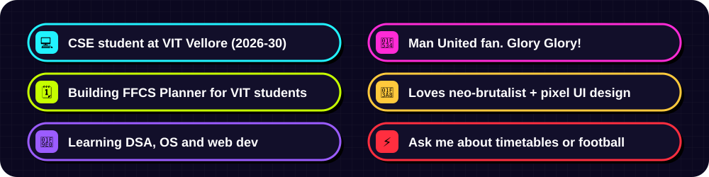
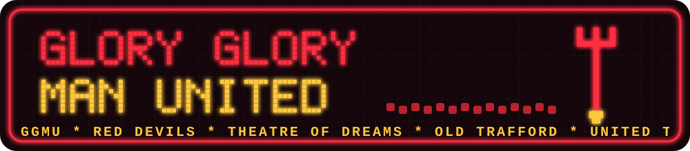

  

  

  

## 🕹️ Featured build

  

  <b><a href="https://ffcs-planner-psi.vercel.app">FFCS Planner</a></b>: checks every clash-free VIT timetable and hands you six different plans, with backups, lab-split questions and teacher reviews.
    
  
  

## 🔴 Matchday mode

  

## 🧰 Toolbox

  

## 📊 Stats

  
  

  

  

🔴 GGMU · pixels drawn by hand in <code>build.js</code> · edit <code>profile.json</code> and run <code>node build.js</code> to change them

